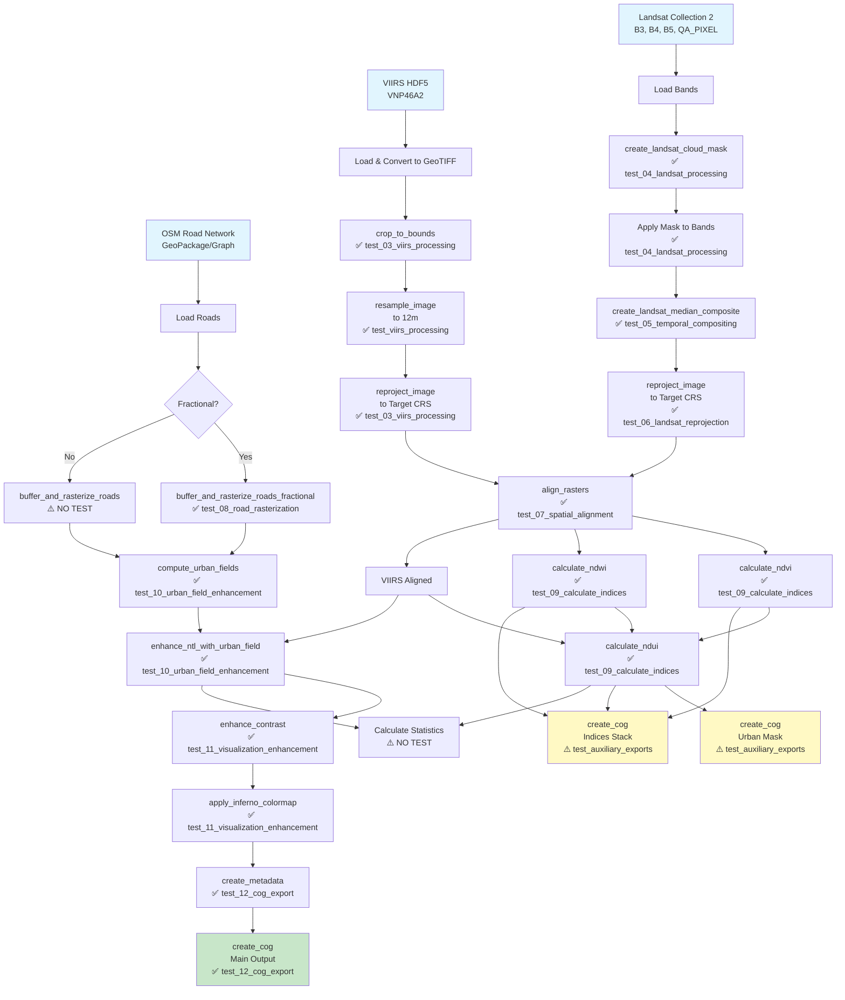

# Black Marble Pipeline Flow Diagram

This diagram shows the data flow through the Black Marble pipeline, with references to test coverage.



## Legend

- 🔵 **Input Data** (Light Blue)
- 🟢 **Main Output** (Light Green) 
- 🟡 **Auxiliary Outputs** (Light Yellow)
- ✅ **Tested Function** - Function is tested in the specified test file
- ⚠️ **Gap in Testing** - Function needs test coverage

## Processing Phases

### Phase 1: Data Loading (I/O)
- Load VIIRS from HDF5 or GeoTIFF
- Load Landsat bands (B3, B4, B5, QA_PIXEL)
- Load OSM road network

### Phase 2: Preprocessing
- **VIIRS**: Crop → Resample → Reproject
- **Landsat**: QA Mask → Apply Mask → Temporal Composite → Reproject
- **Roads**: Buffer and Rasterize (fractional or binary)

### Phase 3: Analysis
- Calculate spectral indices (NDVI, NDWI)
- Calculate NDUI (urban index)
- Compute urban fields from roads
- Enhance NTL with urban fields

### Phase 4: Visualization
- Enhance contrast (percentile stretching)
- Apply colormap (Inferno)

### Phase 5: Export
- Create metadata
- Export main COG (RGB visualization)
- Export auxiliary products (urban mask, indices)
- Calculate statistics

## Test Coverage by Phase

| Phase | Coverage | Missing Tests |
|-------|----------|---------------|
| Data Loading | N/A (I/O) | - |
| Preprocessing | 90% | Binary road rasterization |
| Analysis | 100% | - |
| Visualization | 100% | - |
| Export | 67% | Auxiliary exports, Statistics |

## Key Test Files

1. **test_pipeline_flow.py** - Main integration test following the exact pipeline flow
2. **test_ndvi_critical_edge_cases.py** - Tests the NDVI near-zero denominator bug fix
3. **test_qa_masking.py** - Comprehensive Landsat QA bit interpretation
4. **test_alignment.py** - Multi-raster spatial alignment scenarios
5. **test_urban_field_enhancement.py** - Multi-scale urban field computation
6. **test_cog_export.py** - COG format validation

## Function Import Verification

All test files import the **exact same functions** used in the pipeline:

```python
# Pipeline imports
from blackmarble.prepare.spatial import crop_to_bounds, reproject_image, align_rasters
from blackmarble.analyze.indices import calculate_ndvi, calculate_ndwi, calculate_ndui

# Test imports (identical)
from blackmarble.prepare.spatial import crop_to_bounds, reproject_image, align_rasters
from blackmarble.analyze.indices import calculate_ndvi, calculate_ndwi, calculate_ndui
```

This ensures that tests exercise the actual production code, not mocked versions.